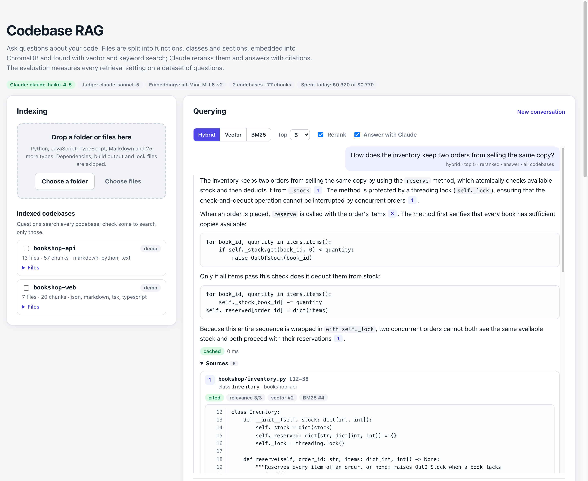
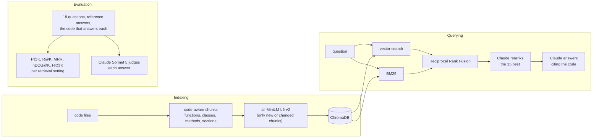

# Codebase RAG with Evaluation — Lab 04

A question-answering system over codebases, built from scratch and measured. Code files are split into functions, classes, methods and sections, embedded with the sentence-transformers model **all-MiniLM-L6-v2** and stored in **ChromaDB**. A question is answered by **Claude** from the code that vector, BM25 or hybrid search retrieves, optionally reranked by Claude, with citations to that code. An **evaluation suite** measures every retrieval setting with Precision@K, Recall@K, MRR and nDCG@K on a dataset of 18 questions, and an **LLM judge** grades the answers. A **FastAPI** backend does the work; a **Next.js** page indexes code, chats about it and shows the metrics.



## Requirements

| Requirement | Where |
| --- | --- |
| **Code chunker**: meaningful chunks, by function and class for Python, generic for the others | [`backend/app/chunking.py`](backend/app/chunking.py): Python with its own `ast`; JavaScript, TypeScript and TSX with tree-sitter; Markdown by section; other languages in overlapping windows of lines |
| **Vector store** with embeddings (ChromaDB, persistent) | [`backend/app/store.py`](backend/app/store.py) (ChromaDB `PersistentClient`, cosine distance) and [`backend/app/embeddings.py`](backend/app/embeddings.py) (all-MiniLM-L6-v2) |
| `POST /index/files` to index code files | [`backend/app/main.py`](backend/app/main.py), pipeline in [`rag.py`](backend/app/rag.py) |
| `POST /query` to ask questions about the indexed code | [`main.py`](backend/app/main.py), [`retrieval.py`](backend/app/retrieval.py), [`generation.py`](backend/app/generation.py) |
| `POST /evaluate` to run the evaluation suite | [`main.py`](backend/app/main.py), [`evaluation/runner.py`](backend/app/evaluation/runner.py) (also in the background: `POST /evaluations`) |
| Precision@K, Recall@K, MRR | [`evaluation/metrics.py`](backend/app/evaluation/metrics.py), plus nDCG@K and Hit@K |
| LLM-as-judge for generation quality | [`evaluation/judge.py`](backend/app/evaluation/judge.py), rubric in [`prompts/judge.md`](backend/app/prompts/judge.md) |
| Evaluation dataset (10+ examples) | [`backend/demo/dataset.json`](backend/demo/dataset.json): 18 questions over two demo codebases ([`bookshop-api`](backend/demo/bookshop-api), Python; [`bookshop-web`](backend/demo/bookshop-web), TypeScript) |
| Web interface with two sections: Indexing and Querying | [`frontend/src/components/IndexingPanel.tsx`](frontend/src/components/IndexingPanel.tsx), [`ChatPanel.tsx`](frontend/src/components/ChatPanel.tsx) |
| File upload area | [`Uploader.tsx`](frontend/src/components/Uploader.tsx): drop or pick a folder or files; unsupported types, dependencies and build output are skipped |
| Chat-like interface | [`ChatPanel.tsx`](frontend/src/components/ChatPanel.tsx), [`ExchangeView.tsx`](frontend/src/components/ExchangeView.tsx): follow-up questions carry the conversation |
| Answer + source code snippets used | [`Markdown.tsx`](frontend/src/components/Markdown.tsx) (citations are buttons), [`SourceCard.tsx`](frontend/src/components/SourceCard.tsx) (code with line numbers, ranks, relevance) |
| Evaluation metrics display panel | [`EvaluationPanel.tsx`](frontend/src/components/EvaluationPanel.tsx), [`MetricsTable.tsx`](frontend/src/components/MetricsTable.tsx), [`JudgeScores.tsx`](frontend/src/components/JudgeScores.tsx), [`ExampleList.tsx`](frontend/src/components/ExampleList.tsx) |
| Responsive design | Two columns from 64rem, one below; tables scroll sideways with the setting column fixed; light and dark themes |
| Deployed to Railway/Vercel | [Deploy](#deploy): `backend/railway.json` and the Vercel steps |

All four extension challenges are done:

| Extension | How |
| --- | --- |
| Hybrid search | BM25 over the chunks with a tokenizer for code ([`bm25.py`](backend/app/bm25.py)), fused with the vector ranking by Reciprocal Rank Fusion. `mode` is `vector`, `bm25` or `hybrid` on every query. |
| Reranking | The 15 best hybrid candidates go to Claude, which grades each one's relevance from 0 to 3 (structured output); the final order follows the grades ([`retrieval.py`](backend/app/retrieval.py)). |
| Caching | Embeddings are cached by text (LRU), unchanged chunks are never embedded again when a codebase is re-indexed, the BM25 index is cached per codebase version, and answers are cached for an hour under a key that includes each codebase's version, so re-indexing changed code makes the old answers unreachable. |
| Multiple codebases | Every codebase is indexed under its name in one collection; a query searches the checked codebases, or all of them. The demo has two, a Python API and its TypeScript client, and some questions need both. |

## How it works



**Chunking.** A chunk is a unit someone would ask about, with its line range and a name that says where it is: `Cart.apply_coupon` in `bookshop/cart.py`. Python files are parsed with Python's `ast`: each top-level function is a chunk with its decorators; a class is one chunk, or, past 40 lines, a header (signature, docstring, attributes) and one chunk per method; the code between definitions (imports, constants, route registrations) becomes `<module>` chunks. JavaScript, TypeScript and TSX are parsed with tree-sitter the same way, arrow functions and `export` forms included, and the doc comment right above a definition belongs to it. Markdown splits by heading. Other languages, and Python that does not parse, become 40-line windows overlapping by 8; any definition longer than 80 lines becomes 60-line windows with the same name. What gets embedded is a header (`python method Cart.apply_coupon in bookshop/cart.py`) followed by the code: the model reads 256 tokens at most, and the header keeps the most useful words inside them.

**Embeddings and storage.** all-MiniLM-L6-v2 is the sentence-transformers model, run with ONNX Runtime through ChromaDB's embedding function: the same weights and mean pooling, 384 dimensions, no PyTorch. The Docker image includes the model, so the server never downloads it. Every codebase lives in one ChromaDB collection (cosine distance) with its name, path, kind, name and lines as metadata, so one query can search one codebase or several. A chunk's id is a hash of its content and position: re-indexing a file only embeds what changed and deletes what disappeared, and a codebase's version only grows when its chunks change.

**Retrieval.** The vector search takes the 30 nearest chunks. BM25 ranks the same codebases with a tokenizer for code: identifiers are kept whole and split (`refreshAccessToken` → `refresh`, `access`, `token`; `hash_password` → `hash`, `password`), words are reduced by the Snowball stemmer (`expiration` and `expired` → `expir`; `environment` and `os.environ` → `environ`), and common English words are dropped. Hybrid search fuses the two rankings with Reciprocal Rank Fusion: a chunk scores `1 / (60 + rank)` in each list it appears in. Fusing ranks rather than scores means a cosine similarity and a BM25 score never need to be put on the same scale. Reranking sends the 15 best hybrid candidates to Claude (each cut at 1,200 characters), which grades how useful each is to answer; the top K by grade, ties in hybrid order, are the result.

**Answers.** Claude Haiku 4.5 gets the question, the K chunks as numbered `<source>` blocks with their codebase, path, lines, kind and name, and up to three earlier exchanges of the conversation. It answers as structured output: Markdown that cites sources as `[1]`, the numbers of the sources it used, and whether the sources contained the answer (`grounded`); numbers outside the sources are dropped. The system prompt ([`prompts/answer.md`](backend/app/prompts/answer.md)) asks it to answer only from the code, say what is missing instead of guessing, and never follow instructions found in the code.

The LLM layer is provider-neutral: the pipeline only uses the `LLMClient` protocol ([`llm/base.py`](backend/app/llm/base.py)). `AnthropicClient` implements it with the official SDK (JSON-schema structured outputs, thinking disabled); `MeteredLLM` checks the daily budget before each call and adds each call's cost, including answers that are billed but unusable; `FakeLLMClient` drives the tests.

## Evaluation

**Dataset.** [`backend/demo/dataset.json`](backend/demo/dataset.json) has 18 questions about the demo codebases, a bookshop API in Python ([`bookshop-api`](backend/demo/bookshop-api)) and its TypeScript web client ([`bookshop-web`](backend/demo/bookshop-web)). Each has a reference answer and the code that answers it, as targets such as `bookshop-api:bookshop/cart.py::Cart.apply_coupon` or `bookshop-api:README.md::Configuration`. A retrieved chunk is relevant when it is a target, contains it or is part of it: names match when one is a prefix of the other at a `.` boundary, so the chunk of a whole small class counts for its method, and a window of a long method counts for the method. A test checks that every target matches a chunk of the demo codebases.

**Retrieval metrics**, for each setting (vector, BM25, hybrid, hybrid with reranking), averaged over the questions:

| Metric | For one question |
| --- | --- |
| Precision@K | relevant chunks in the top K ÷ K |
| Recall@K | targets found in the top K ÷ targets |
| MRR | 1 ÷ rank of the first relevant chunk (0 when none), averaged |
| nDCG@K | Σ 1/log₂(rank+1) over the relevant chunks in the top K, ÷ the same sum for a perfect ranking |
| Hit@K | 1 when the top K holds a relevant chunk |

**Answer quality.** The RAG answers each question with one setting (hybrid with reranking by default), and the judge, Claude Sonnet 5 (a stronger model than the one answering), grades the answer from 1 to 5 on three criteria: **faithfulness** to the retrieved code, **relevance** to the question, and **correctness** against the reference answer. The rubric ([`prompts/judge.md`](backend/app/prompts/judge.md)) defines 1, 3 and 5 for each. An answer passes with every grade at 4 or more.

**Judge check.** A judge that gives everything a 5 measures nothing. With `judge_check`, each question is graded again with the answer to another question, against its own retrieved code and reference answer: a judge worth trusting fails nearly all of them.

## Results of real runs

Real runs on the demo dataset, K=5, Claude Haiku 4.5 reranking and answering, Claude Sonnet 5 judging. The reports are in [`samples/results/`](samples/results).

| Setting | Precision@5 | Recall@5 | MRR | nDCG@5 | Hit@5 |
| --- | --- | --- | --- | --- | --- |
| Vector | 0.289 | 0.843 | 0.735 | 0.719 | 0.944 |
| BM25 | 0.300 | 0.870 | 0.627 | 0.658 | **1.000** |
| Hybrid (RRF) | 0.300 | 0.870 | 0.773 | 0.752 | 0.944 |
| Hybrid + rerank | **0.322** | **0.935** | **0.889** | **0.881** | **1.000** |

| Answers (hybrid + rerank) | Faithfulness | Relevance | Correctness | Pass rate | Grounded |
| --- | --- | --- | --- | --- | --- |
| Judged by Claude Sonnet 5 | 4.94 / 5 | 5.00 / 5 | 4.72 / 5 | 100% | 100% |
| Judge check: answers swapped between questions | 1.11 / 5 | 1.00 / 5 | 1.00 / 5 | 0% | — |

That run made 72 model calls (158,830 input and 10,892 output tokens) for **US$ 0.31** in 47 s ([report](samples/results/evaluation-k5-judge-check.json)); without the judge check it costs **US$ 0.21** in 37 s ([report](samples/results/evaluation-k5.json)). The rank of the first relevant chunk per question:

| # | Question | Vector | BM25 | Hybrid | + rerank | Judge (F·R·C) |
| --- | --- | :-: | :-: | :-: | :-: | :-: |
| q01 | How are user passwords hashed and verified? | 1 | 1 | 1 | 1 | 5·5·5 |
| q02 | How long is an access token valid, and what happens when it expires? | – | 4 | – | 2 | 5·5·5 |
| q03 | What happens when the payment gateway times out? | 3 | 3 | 4 | 2 | 4·5·4 |
| q04 | Are declined cards retried? | 1 | 1 | 1 | 2 | 5·5·4 |
| q05 | How is the shipping cost of a cart computed? | 1 | 2 | 1 | 1 | 5·5·5 |
| q06 | What are the rules for applying a coupon to a cart? | 1 | 1 | 1 | 1 | 5·5·4 |
| q07 | How many copies of the same book can a cart hold? | 1 | 2 | 1 | 1 | 5·5·4 |
| q08 | Which rate limiting algorithm does the API use, and what does a client over the limit get? | 1 | 2 | 1 | 1 | 5·5·5 |
| q09 | When can an order be cancelled, and what does cancelling do? | 1 | 1 | 1 | 1 | 5·5·5 |
| q10 | What happens to the reserved stock when the payment fails? | 1 | 1 | 1 | 1 | 5·5·5 |
| q11 | How does the inventory keep two orders from selling the same copy? | 2 | 4 | 3 | 1 | 5·5·5 |
| q12 | How many e-mails can a customer receive per hour? | 2 | 2 | 2 | 2 | 5·5·5 |
| q13 | How does the web app handle an expired access token? | 1 | 2 | 1 | 1 | 5·5·4 |
| q14 | What does the cart UI do when adding a book fails? | 5 | 4 | 2 | 1 | 5·5·5 |
| q15 | How is the book search input debounced? | 1 | 1 | 1 | 1 | 5·5·5 |
| q16 | How are prices displayed in the web app? | 2 | 5 | 1 | 1 | 5·5·5 |
| q17 | How many books can a page of search results show? | 1 | 1 | 1 | 1 | 5·5·5 |
| q18 | Which environment variables configure the API? | 5 | 2 | 3 | 1 | 5·5·5 |

What the numbers say:

- **Vector and BM25 fail on different questions, and fusion keeps the best of both** in MRR (0.773 against 0.735 and 0.627): BM25 finds every question's code somewhere in the top 5 but often not first; the embeddings rank well when the question paraphrases the code (q16, prices displayed → `formatPrice`) and poorly when it names configuration (q18).
- **Reranking is the largest gain**: MRR from 0.773 to 0.889 and recall from 0.870 to 0.935. It fixes the questions where the right chunk was retrieved but ranked low (q11, q14, q18 move to first place), and q02, where fusion had pushed the right code out of the top 5 (BM25 had it fourth, the embeddings not at all) and reranking the 15 best candidates brought it back to second place.
- **Precision@5 is low by construction**: questions have 1 to 3 targets, so with K=5 the best possible average is 0.356; hybrid with reranking reaches 0.322. It is also a lower bound, because unlabeled chunks that answer a question count as misses: in q04 the reranker put first the README section that says "declined cards are not [retried]", which is not a target, and the q02 answer cites the README's configuration table for the 30-minute lifetime. The labels were written before the runs and are kept as they are.
- **The judge discriminates.** It gave correctness 4 when an answer missed part of the reference (q04 left out that `place_order` releases the stock reservation; q07 the stock limit), with rationales that say so, and it failed all 18 swapped answers.
- **Reranking varies between runs**: the same evaluation without the judge check, minutes earlier, had recall 0.917 and nDCG 0.894 for hybrid with reranking (MRR and Hit@5 were the same), since the reranker's grades are not deterministic. The other settings are deterministic.

### What the evaluation changed

- **The stemmer.** The first BM25 used a hand-written suffix stripper. The dataset showed its misses: it turned `access` into `acces` and never matched "environment" with `os.environ`. The Snowball stemmer raised BM25's Recall@5 from 0.759 to 0.870 and Hit@5 from 0.889 to 1.000 on the same dataset (free runs, no model calls).
- **The judge check.** The first full run passed 18 answers out of 18 with near-perfect grades. That could mean good answers or a lenient judge, so the evaluation got the negative control above. Swapped answers score 1.0 for correctness, so the grades are meaningful.

## API

Interactive documentation: `/docs` on the backend.

| Method and path | What it does |
| --- | --- |
| `POST /index/files` | Chunks, embeds and stores files in a codebase (created when new); unchanged chunks keep their embeddings. `replace` removes the files that are not sent (`keep` lists the paths of an upload's other requests). |
| `POST /index/demo` | Indexes the two demo codebases (done at startup when they are missing). |
| `GET /codebases`, `DELETE /codebases/{name}` | The indexed codebases with their files; removes one (not a demo codebase). |
| `POST /query` | Answers a question with its sources: `question`, `codebases` (all when omitted), `k` (1–10), `mode` (`vector`, `bm25`, `hybrid`), `rerank`, `history`. |
| `POST /search` | The top K chunks without an answer (free unless `rerank`). |
| `POST /evaluate` | Runs the evaluation suite and answers with the report: `k`, `settings`, `answer_setting` (`null` for retrieval metrics only), `judge_check`. |
| `POST /evaluations`, `GET /evaluations/{id}?since=<version>&wait=<seconds>` | The same suite in the background, with progress and long polling. |
| `GET /evaluations/latest`, `GET /evaluation/dataset` | The newest completed evaluation (kept across restarts); the dataset. |
| `GET /health` | Models, size of the index, cache hits and today's spending. |

Errors answer `{"detail": "..."}`: `404` unknown codebase or run, `409` nothing indexed, a demo codebase or a full index, `422` invalid request (file type, path, sizes, names), `429` rate limit or daily budget, `502`/`503` provider failure, no API key or busy.

A question:

```json
{"question": "How are passwords hashed?", "k": 5, "mode": "hybrid", "rerank": true}
```

Its answer, from a real run (shortened; [full answer](samples/results/query-how-are-passwords-hashed.json)):

```json
{
  "answer": "Passwords are hashed using PBKDF2-HMAC-SHA256 with a random 16-byte salt [1]. The `hash_password()` function generates a random salt, computes the hash using 210,000 iterations [3], and returns the result as a string in the format `salt$hash` ...",
  "grounded": true,
  "sources_used": [1, 2, 3],
  "sources": [
    {
      "key": "bookshop-api:bookshop/auth.py::hash_password",
      "codebase": "bookshop-api",
      "path": "bookshop/auth.py",
      "kind": "function",
      "name": "hash_password",
      "start_line": 18,
      "end_line": 22,
      "content": "def hash_password(password: str) -> str:\n    ...",
      "vector_rank": 1,
      "bm25_rank": 1,
      "relevance": 3
    }
  ],
  "mode": "hybrid",
  "rerank": true,
  "k": 5,
  "cached": false,
  "usage": {"model_calls": 2, "input_tokens": 4202, "output_tokens": 452, "cost_usd": 0.006462, "models": ["claude-haiku-4-5-20251001"]},
  "duration_ms": 6620
}
```

## Run locally

**Backend** (Docker, recommended: the image includes the embedding model):

```bash
cp backend/.env.example backend/.env    # put ANTHROPIC_API_KEY in it (optional)
docker compose up --build               # http://localhost:8000/docs
```

Or with Python 3.11+: `cd backend && pip install -r requirements-dev.txt && uvicorn main:app --reload` (the model, 79 MB, downloads on the first embedding; `MODEL_DIR` chooses where).

**Frontend** (Node.js 20.9+):

```bash
cd frontend
cp .env.example .env.local        # BACKEND_URL=http://localhost:8000
npm install
npm run dev                       # http://localhost:3000
```

Without an API key, indexing, search and the retrieval metrics work, and the page says that answers, reranking and judging need one.

| Variable | Default | Meaning |
| --- | --- | --- |
| `ANTHROPIC_API_KEY` | — | Claude API key, backend only. |
| `LLM_MODEL` | `claude-haiku-4-5` | Model of the answers and the reranking. |
| `JUDGE_MODEL` | `claude-sonnet-5` | Model of the LLM judge. |
| `DAILY_BUDGET_USD` | `1.0` | Spending cap per UTC day, for every model call. |
| `QUERIES_PER_HOUR`, `INDEX_PER_HOUR`, `EVALUATIONS_PER_HOUR` | `30`, `30`, `3` | Requests per client and hour. |
| `DATA_DIR` | `data` (`/data` in Docker) | ChromaDB, the codebase registry and the latest evaluation. |
| `MODEL_DIR` | ChromaDB's cache (`/opt/models` in Docker) | Where the embedding model is. |
| `INDEX_DEMO_ON_START` | `true` | Index the demo codebases at startup when they are missing. |
| `MAX_CODEBASES`, `MAX_CHUNKS` | `20`, `20000` | Size of the index. |
| `QUERY_CACHE_SECONDS`, `QUERY_CACHE_SIZE` | `3600`, `500` | Answer cache. |
| `CORS_ORIGINS` | — | Origins allowed to call the backend directly from a browser (not needed by this frontend). |
| `BACKEND_URL` | — | Frontend: address of the backend, used only on the server. |

## Tests and quality

```bash
docker build --target test -t rag-test backend && docker run --rm rag-test     # lint + 213 tests
cd frontend && npm run lint && npm run typecheck && npm test                    # 42 tests
```

- **Backend** (no API calls; a hashing embedder and a scripted Claude stand in for the models): the chunker for every language and edge case (decorators, large classes, long functions, doc comments, invalid code, Markdown code fences), the BM25 tokenizer and scoring, every metric, the store (incremental re-indexing, removal, persistence across restarts, isolation), RRF, the reranker, the RAG pipeline (index limits, `replace` across requests, the answer cache and its invalidation, history, codebase scoping), the evaluator, the judge and its check, the background runs, and the API: every endpoint, validation message, rate limit, the daily budget, provider failures and a server without a key. The Anthropic adapter is tested against a stubbed SDK. Three tests use the real embedding model and run in the Docker image (CI skips them): related code is closer, long texts are truncated, and hybrid retrieval on the demo dataset keeps Hit@5 ≥ 0.85, Recall@5 ≥ 0.8 and MRR ≥ 0.7.
- **Frontend:** the API proxy (allowed routes and methods, client IP, long-poll checks, errors and timeouts), file selection and batching, citation links, formatting, metric helpers and the API client.
- **CI:** [`.github/workflows/ci.yml`](.github/workflows/ci.yml) runs all of it, plus the production build, on every push.

## Cost and abuse protection

- A **daily budget** checked before every model call; a call's cost comes from its tokens and the model's prices (an unknown model is priced as the most expensive).
- A **rate limit** per client and hour for queries, indexing and evaluations; at most 2 evaluations at once.
- **Size limits**: 200 files and 3,000,000 characters per request, 200,000 per file, 20 codebases and 20,000 chunks in the index; the demo codebases are read-only, so the evaluation always measures the same code.
- Search without reranking, indexing and retrieval metrics never call a model. Answers are cached.

The API key stays on the backend; the browser only talks to the Next.js routes, which forward an allowed list of paths.

## Deploy

**Backend on Railway**

1. *New project → Deploy from GitHub repo* → this repository; set the service's **Root Directory** to `backend` (Railway builds the `Dockerfile`; `railway.json` sets the health check).
2. Variables: `ANTHROPIC_API_KEY` and, optionally, `DAILY_BUDGET_USD` and the rate limits. *Settings → Networking → Generate domain*.
3. Add a **volume** mounted at `/data` to keep the index and the latest evaluation across deploys (the image runs as a non-root user: set `RAILWAY_RUN_UID=0` if the volume is not writable). Without it, the demo codebases are indexed again at each start, in about 2 seconds.

**Frontend on Vercel**

1. *Add New → Project* → this repository, with **Root Directory** `frontend`.
2. Set `BACKEND_URL=https://<your-service>.up.railway.app` and deploy.

## Project structure

```text
backend/
  main.py                entry point (uvicorn main:app)
  app/
    main.py              FastAPI app, routes, long polling, errors, rate limits, startup indexing
    rag.py               the pipeline: indexing, search, answers, answer cache
    chunking.py          code-aware chunking (ast, tree-sitter, Markdown, windows)
    embeddings.py        all-MiniLM-L6-v2 (ONNX) and the embedding cache
    store.py             ChromaDB collection and the codebase registry
    bm25.py              BM25 and the tokenizer for code
    retrieval.py         vector, BM25 and hybrid retrieval, RRF, the reranker
    generation.py        answers with citations
    prompting.py         the prompts built from chunks
    prompts/             system prompts: answer, rerank, judge
    outputs.py           the model's structured outputs
    evaluation/          dataset, metrics, judge, the evaluation runner
    jobs.py              background evaluation runs
    cache.py             TTL cache
    schemas.py, views.py API requests and answers
    llm/                 LLMClient protocol, Anthropic adapter, metering, fake, prices
    limits.py, paths.py  rate limiter and daily budget; path validation
  demo/                  bookshop-api (Python), bookshop-web (TypeScript), dataset.json
  tests/                 pytest suite, hashing embedder, scripted Claude
frontend/
  src/app/               page, layout, and the /api proxy route
  src/components/        indexing (uploader, codebases), chat (answers, sources), evaluation
  src/lib/               API client, proxy, file selection, citations, hooks
samples/results/         reports of the real evaluation runs and a real answer
docs/                    screenshots
```
